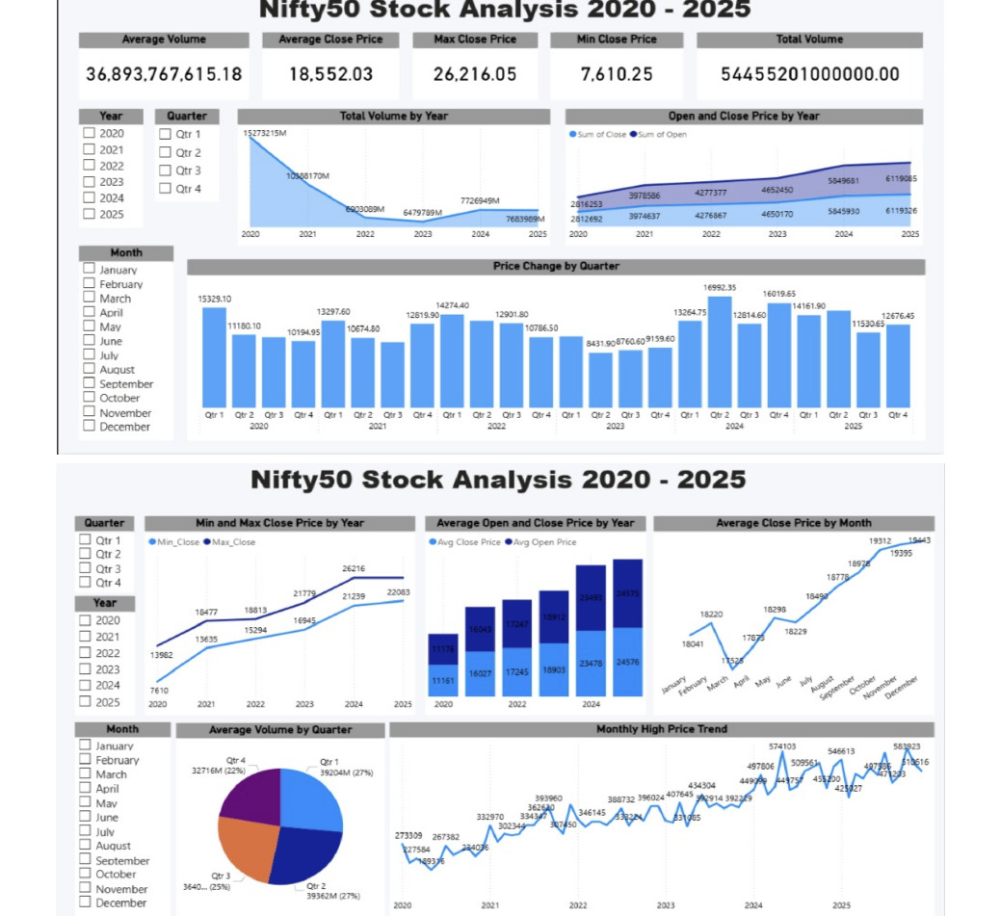

# NiftyPulse: Nifty 50 Market Analysis (2020–2025)

An interactive **Power BI** dashboard that turns six years of daily Nifty 50 index data into a clear picture of price trends, trading volume and market behaviour, built so that people without a finance background can explore it too.

## Problem

Daily stock market data is large and hard to read: thousands of rows of open, high, low and close prices and volumes. Beginners struggle to see trends, highs and lows, or how trading activity changes over time without doing manual calculations. This dashboard summarises it in a few interactive views.

## What the dashboard shows

**KPI cards:** average volume, average close price, maximum and minimum close price, and total volume.

**Views:**
- Total trading volume by year
- Open vs close price by year
- Price change by quarter
- Minimum and maximum close price by year
- Average close price by month
- Average volume by quarter
- Monthly high-price trend

**Filters:** year, quarter and month slicers apply to every view at once.

## Key findings

- **The index rose about 3.4× from its low:** the lowest close in the period was 7,610 (during the 2020 crash) and the highest was 26,216, with an average close of 18,552.
- **Trading volume peaked in 2020** and fell by more than half by 2023, even as prices kept climbing. Activity was highest during the 2020 volatility, not during the later rally.

## Approach

1. **Power Query:** cleaned the raw data by converting text to numbers, parsing dates, handling volume units like "M", and adding year, quarter and month columns.
2. **DAX measures:** the KPIs and aggregates (averages, min and max, totals, period changes).
3. **Design:** a consistent layout of KPI cards on top, trend charts below and slicers on the left.

## Repository

| File | What it is |
|---|---|
| `Nifty50 Stock Analysis.pbix` | The Power BI dashboard (open in Power BI Desktop) |
| `Nifty50 Stock Analysis.pdf` | PDF export of the dashboard, with intro and problem statement |
| `Nifty 50 Historical Data.csv` | Sample of the daily index data |
| `figures/dashboard.png` | Dashboard image used above |

## Next steps

- Add moving averages and volatility indicators
- Bring in news sentiment around big market moves
- Compare the Nifty 50 with other indices

## Tools

Power BI, Power Query, DAX

---

[Tisya Vaidya](https://tisyavaidya.com) · [LinkedIn](https://www.linkedin.com/in/tisya-vaidya/) · [GitHub](https://github.com/tisyavaidya)
